# Lyme Disease in Wisconsin: What You Need to Know

By Aarav Coppisetty, Dr. Brooke Crotty  
_Published November 8, 2026_

## TL;DR

Lyme disease has quietly become a Wisconsin problem. According to CDC data, Wisconsin is among the [top 5 states in the U.S.](https://www.cdc.gov/lyme/data-research/facts-stats/surveillance-data-1.html) for reporting Lyme disease cases. This article explains how it spread, why the risk keeps growing, and how to protect yourself.

  

Two things have happened at once: Lyme disease has spread to cover the entire state, and within that area it has grown far more common. No single cause explains both, and this article explores why.

We also want you to know how to protect yourself and your loved ones, recognize the signs of infection, and seek medical care quickly if needed. By staying informed, you can stay safe and get the right treatment as soon as possible.

## What is Lyme Disease

Lyme disease is a [zoonotic](https://www.cdc.gov/one-health/about/about-zoonotic-diseases.html) (meaning it spreads from animals to humans) bacterial infection spread by ticks. In fact, it is the [most common vector-borne disease in the United States](https://www.cdc.gov/lyme/). The bacteria that cause the disease are called *Borrelia burgdorferi*.

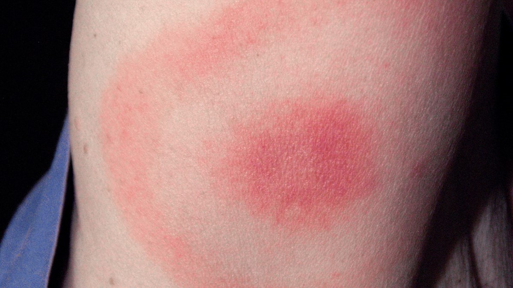

_Bullseye-shaped rash near where the tick bit you. Image credit: [CDC](https://www.cdc.gov/lyme/signs-symptoms/?CDC_AAref_Val=https://www.cdc.gov/lyme/signs_symptoms/index.html)._

### Common Symptoms

- Bullseye-shaped rash near where the tick bit you
- Feeling very tired (fatigue)
- Pain or swelling in your joints
- Fever
- Numbness or tingling
- Dizziness
- Headaches
- Mood swings

If you get bitten, you might get symptoms in a few days or weeks. Most people get better if they get help early. But if you don’t, Lyme disease can last for months or even years and get much worse.

## How Lyme Disease Bacteria Affects the Body (physiology)

Sometimes Lyme disease can cause problems with your brain and nervous system. *Borrelia burgdorferi,* the bacteria that causes Lyme, can cause inflammation, which is swelling, as your body fights the infection.

This can lead to:

- Problems with memory
- Feeling sad or angry for no reason
- Trouble sleeping
- Headaches or being confused

Doctors are still studying exactly how all this happens, but most people do get better if they see a doctor soon and get treatment.

 

_Borrelia burgdorferi, the bacteria that causes Lyme disease. Image Credit: [Global Lyme Alliance](https://www.globallymealliance.org/news/yale-scientists-unlock-new-insight-into-the-lyme-disease-bacteria/)._

## How Lyme Disease Spreads

Lyme disease comes from the bite of a blacklegged tick. Here’s how it usually happens:

Ticks pick up the Lyme bacteria when they bite white-footed mice. Deer can also carry lots of ticks, but they don’t get sick themselves because their bodies fight off the bacteria. Once a tick bites a person, it may pass the infection into the bloodstream.

The good news is that Lyme disease cannot spread from one person to another, so you can’t catch it from your friends or family.

## Tick Range Expansion

Over the last 25 years, Lyme disease has steadily spread across Wisconsin. It went from high levels in just 47 counties in 2001 to all 72 counties by 2022. One reason is that the blacklegged ticks that carry Lyme disease are surviving farther north and in more places than they once did.

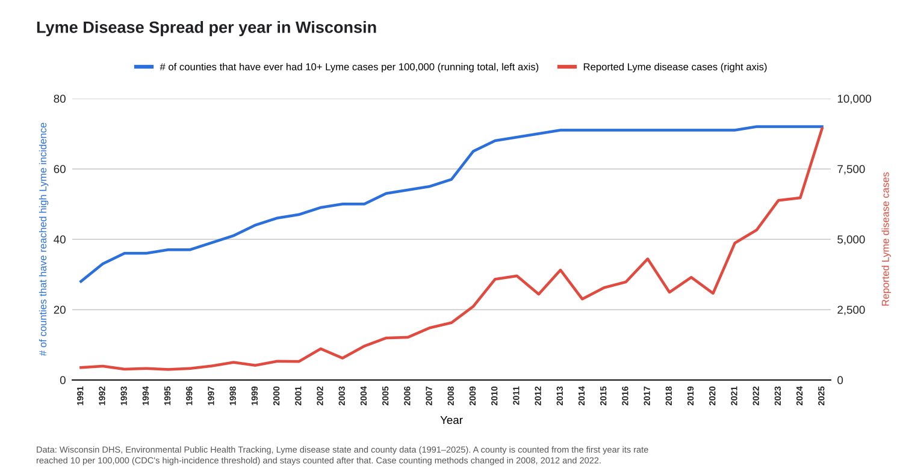

_Even after Lyme disease reached high levels in every Wisconsin county, the number of reported cases kept climbing. Reported cases rose from 654 in 2001 to 8,930 in 2025, more than 13 times as many in the same state._

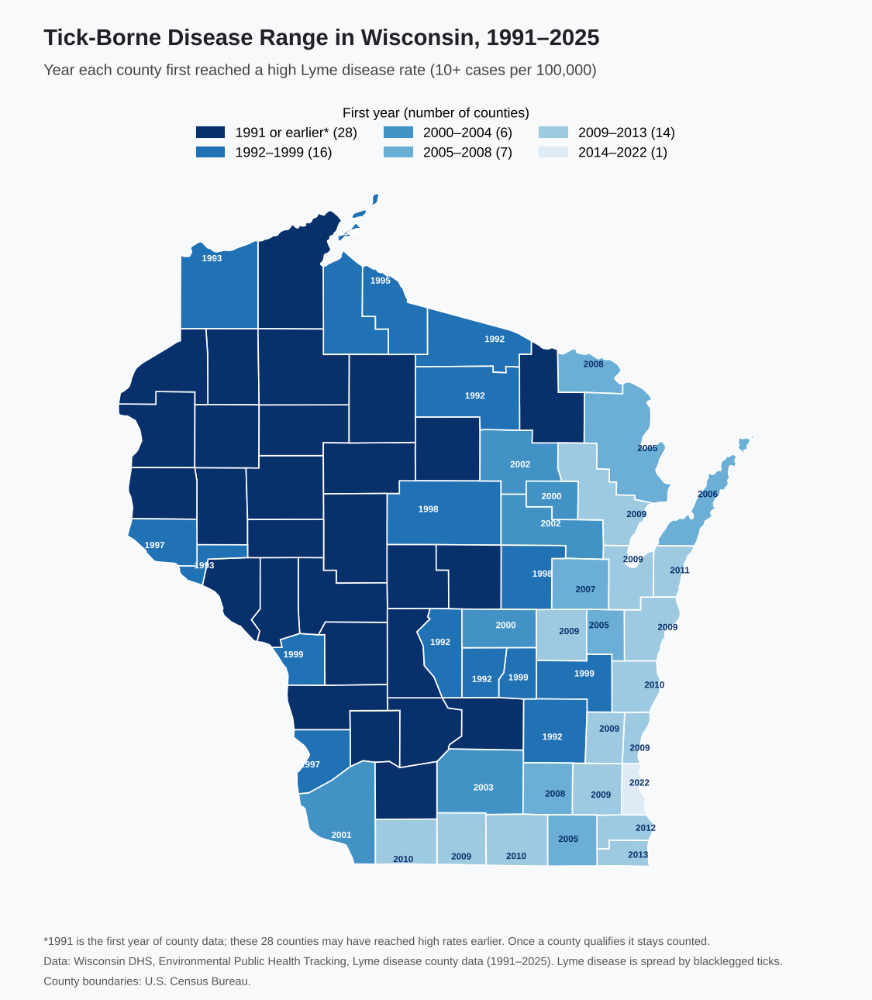

_Figure created by the authors using [Wisconsin DHS Environmental Public Health Tracking data](https://www.dhs.wisconsin.gov/epht/lyme.htm); county boundaries from the U.S. Census Bureau._

## Correlation of Climate Change & Tick Numbers

Warmer weather is part of the story, but it’s only part. As our planet gets warmer, ticks are able to stay active for longer periods each year. Deer ticks, for example, can become active at temperatures above 40°F. This matters because the more days they are active, the more chances they have to bite people.

Between 2001 and 2025, the number of days with temperatures above 40°F in Madison increased from about 265 to more than 280 per year. That means ticks may now be active for about 16 more days each year compared to 25 years ago. This is a meaningful increase.

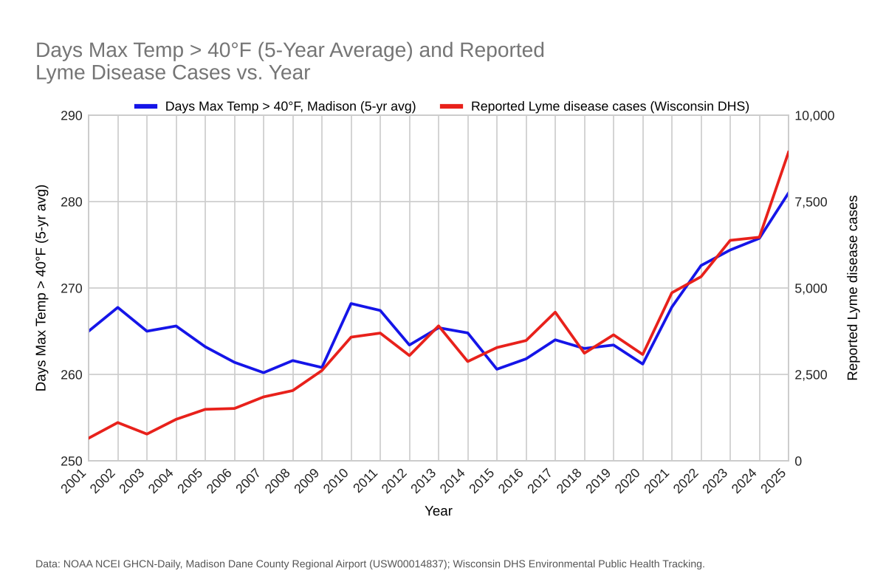

_Both have risen in recent years. Year to year they don’t always move together, and part of the case increase after 2022 comes from new counting rules._

Another piece of bad news is that the average high temperature in Madison is also rising. From 2001 to 2005, it averaged 57.2°F, but from 2021 to 2025 it averaged 58.8°F. That’s an increase of about 1.6°F.

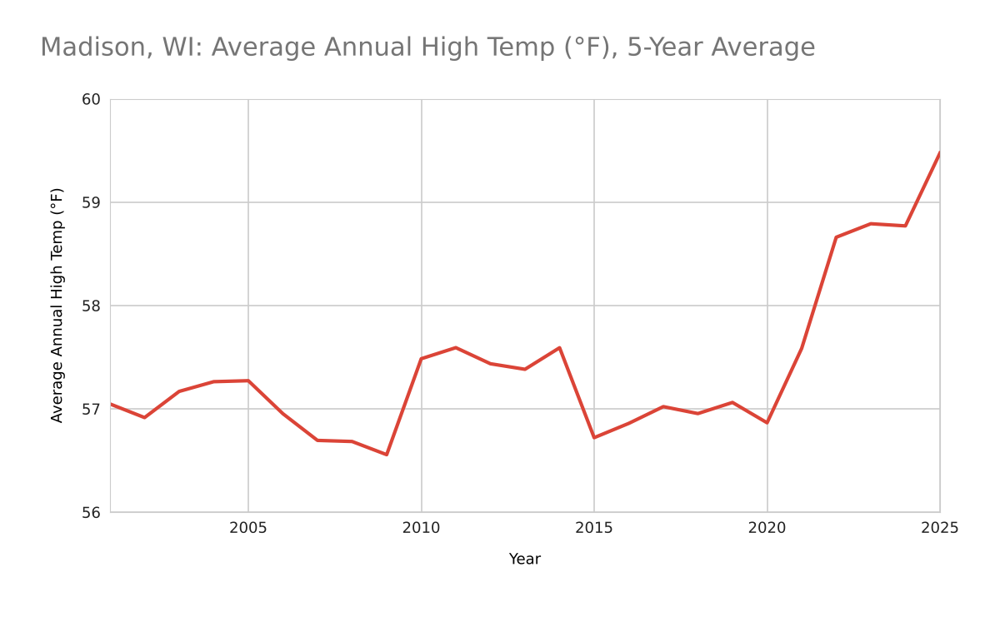

_Climate Data Credit: [NOAA](https://www.ncei.noaa.gov/cdo-web/datasets)_

The days-above-40°F graph and the average-high graph look very similar; the years with the highest temperatures also have the most days over 40°F, which means more tick activity.

## Increase in reported Lyme Disease cases in the state of Wisconsin

Let’s see how many cases of Lyme disease were reported over time. The blue dots represent the reported cases of Lyme disease. When you think each dot could be you or your loved one, this gets really scary very quickly.

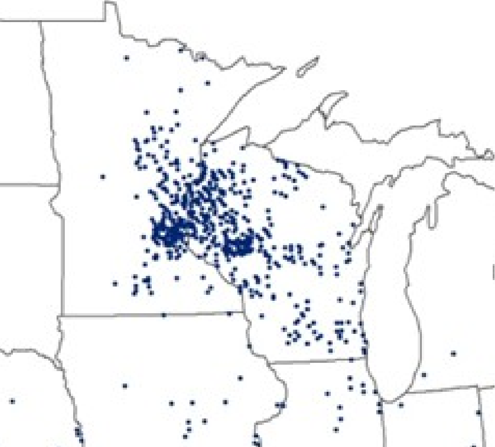

_Reported cases of Lyme disease in 1995. Image Credit: [CDC](https://www.cdc.gov/lyme/data-research/facts-stats/lyme-disease-case-map.html#cdc_data_surveillance_section_3-reported-cases-of-lyme-disease)_

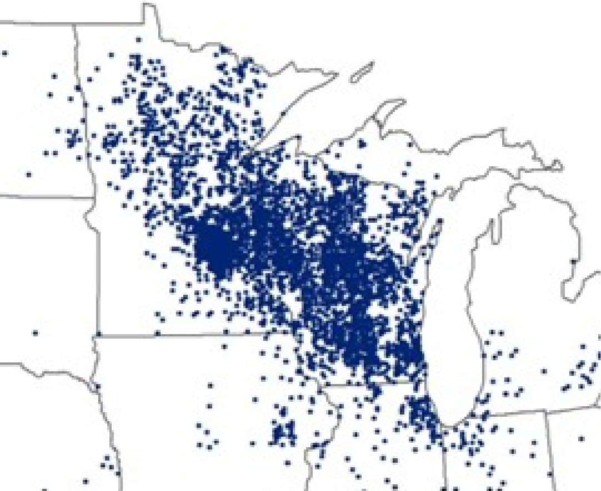

_Reported cases of Lyme disease in 2010. Image Credit: [CDC](https://www.cdc.gov/lyme/data-research/facts-stats/lyme-disease-case-map.html#cdc_data_surveillance_section_3-reported-cases-of-lyme-disease)_

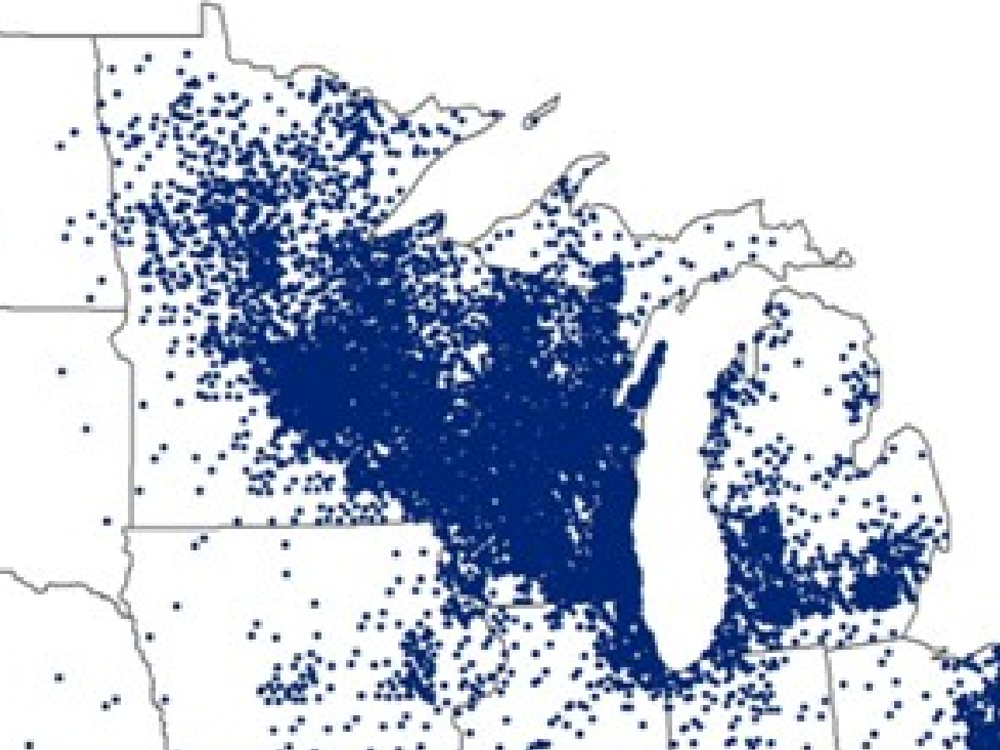

_Reported cases of Lyme disease in 2023. Image Credit: [CDC](https://www.cdc.gov/lyme/media/images/2025/02/2023-Lyme-map-for-website-annotated.jpg)_

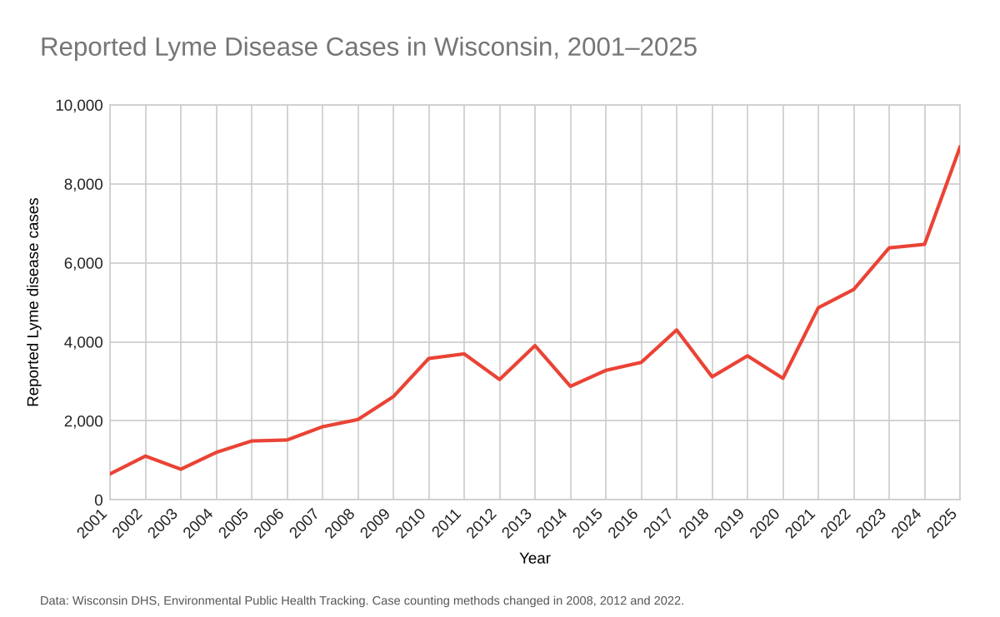

_Data Credit: [Wisconsin DHS](https://www.dhs.wisconsin.gov/epht/lyme.htm)_

The incidence of Lyme disease in Wisconsin also jumped, from 12.1 cases per 100,000 people in 2001 to 149.5 per 100,000 in 2025. Part of this increase reflects changes in how cases are counted.

## How to Protect Yourself

While there could be other factors, like awareness and accurate diagnosis of Lyme disease by doctors and better testing, which could result in an increase of Lyme disease numbers, it is still alarming how fast the disease is spreading.

Here are some easy things you can do:

- Wear long sleeves, pants, socks, and boots when you’re outside in grassy or wooded areas.
- Use [EPA-approved](https://www.epa.gov/insect-repellents/find-repellent-right-you) tick repellents.
- Check your whole body and your pets for ticks after being outdoors. Don’t forget your scalp, behind your knees, and your underarms.
- Take a shower soon after coming inside. This can help remove ticks.

If you find a tick, it’s important to take it off right away using fine-tipped tweezers. Here’s how to do it safely: [CDC Tick Removal Guide](https://www.cdc.gov/ticks/after-a-tick-bite/index.html).

## Tick Life Cycle

Did you know that more than one species of tick can spread Lyme disease? In Wisconsin, the most common one is *Ixodes scapularis*, also called the deer tick or blacklegged tick. Its cousin, the western blacklegged tick, can also carry the bacteria in some regions.

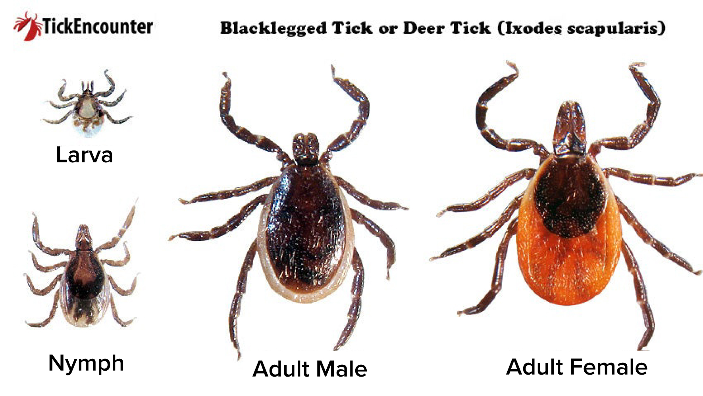
_Ixodes scapularis, nymphal stages to adult (left to right) Image credit: [LSU AgCenter](https://www.lsuagcenter.com/articles/page1776173280639)_

## Data and Trends in our Wisconsin

On average, about 350 more Lyme disease cases are reported in Wisconsin each year. Possible reasons include:

- The weather is getting warmer
- There are more ticks
- The deer population is growing

Deer matter too, since they feed the ticks, but they don’t explain the rise on their own. Even in years when the deer population went down, the number of reported Lyme disease cases continued to increase.

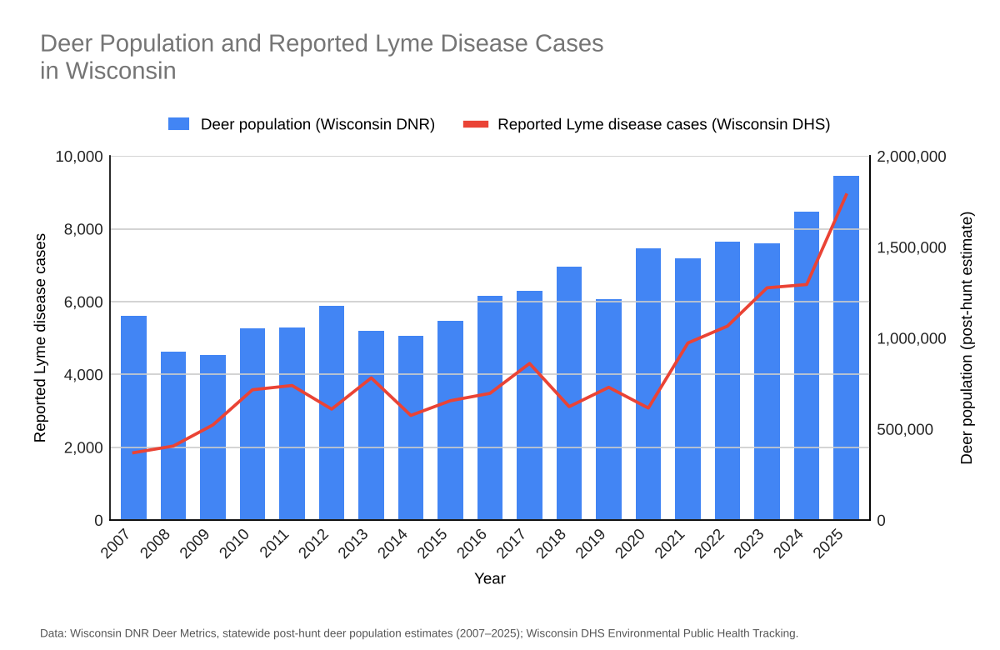

_Data Credit: [Wisconsin DNR](https://apps.dnr.wi.gov/deermetrics/DeerStats.aspx?R=2) (deer), [Wisconsin DHS](https://www.dhs.wisconsin.gov/epht/lyme.htm) (Lyme cases)_

## Conclusion

Lyme disease is serious and it’s becoming more common in Wisconsin due to a mix of warmer weather, more ticks, and better testing. But you can keep yourself safe by following these tips and helping others learn the facts.

The disease is spreading, rising, and still not fully understood. Until science catches up, the best protection is a simple habit: check for ticks, and check early.

Stay safe by avoiding tall grass, checking for ticks whenever possible and spreading the word about ticks and Lyme Disease!

## Next Up

We are currently working on a predictive simulation to better map out the likelihood of Lyme and trying to find out how deer-diseases like EHD (Epizootic Hemorrhagic Disease) will interact with Borrelia infection.

## Acknowledgments

Thank you to Dr. Brooke Crotty for mentoring me through this project for over a year and helping me understand how Lyme disease affects the body. Dr. Crotty also checked the medical facts in this article for accuracy and showed me how to apply a centered five-year moving average to the temperature data so the long-term trend would stand out from year-to-year swings.

Thank you to my mom, Deepthi Rao Coppisetty, for teaching me how to find and analyze public health and climate data. She also taught how to publish this article on GitHub.

## Glossary

- **Zoonotic**: A disease that spreads from animals to humans. [NIH Source](https://www.niaid.nih.gov/diseases-conditions/zoonotic-diseases)
- **Physiology** (body systems): How a disease affects the body’s systems (like your brain, nerves, or joints). [NIH Lyme Disease](https://www.niaid.nih.gov/diseases-conditions/lyme-disease)
- **Inflammation**: When your body reacts to infection or injury and the area gets red or swollen. [NIAMS Inflammation](https://www.niehs.nih.gov/health/topics/conditions/inflammation)
- **Tick life stages**: Ticks grow from larvae to nymphs and then to adults. Ticks usually spread Lyme disease to people when they are nymphs. [CDC Tick Life Cycle](https://www.cdc.gov/ticks/about/tick-life-cycle.html)
- ***Borrelia burgdorferi***: The bacteria responsible for Lyme disease.

**Sources**: Centers for Disease Control and Prevention (CDC), Wisconsin Department of Health Services, National Institutes of Health (NIH), Environmental Protection Agency (EPA), National Oceanic and Atmospheric Administration (NOAA), and other public health sources.

## References

1. Wisconsin Department of Health Services. (2026). *Environmental Public Health Tracking: Lyme disease, state and county data, 1991–2025* [Data set]. [https://www.dhs.wisconsin.gov/epht/lyme.htm](https://www.dhs.wisconsin.gov/epht/lyme.htm)

2. Wisconsin Department of Health Services. (2026). *Lyme disease: Wisconsin data*. [https://www.dhs.wisconsin.gov/tick/lyme-data.htm](https://www.dhs.wisconsin.gov/tick/lyme-data.htm). Accessed October 2026.

3. Menne, M. J., Durre, I., Korzeniewski, B., McNeill, S., Thomas, K., Yin, X., Anthony, S., Ray, R., Vose, R. S., Gleason, B. E., & Houston, T. G. (2012). *Global Historical Climatology Network – Daily (GHCN-Daily)*. NOAA National Climatic Data Center. [https://doi.org/10.7289/V5D21VHZ](https://doi.org/10.7289/V5D21VHZ). Station: Madison Dane County Regional Airport, WI (USW00014837), 2001–2025. Data download: NOAA NCEI daily summaries.

4. Wisconsin Department of Natural Resources. (2026). *Wisconsin deer metrics: Herd abundance, statewide post-hunt deer population estimates, 2007–2025*. [https://apps.dnr.wi.gov/deermetrics/DeerStats.aspx?R=2](https://apps.dnr.wi.gov/deermetrics/DeerStats.aspx?R=2)

5. U.S. Census Bureau. *Cartographic boundary files: Counties*. [https://www.census.gov/geographies/mapping-files/time-series/geo/cartographic-boundary.html](https://www.census.gov/geographies/mapping-files/time-series/geo/cartographic-boundary.html)

6. Centers for Disease Control and Prevention. *Lyme disease case maps (1995, 2010, 2023)*. [https://www.cdc.gov/lyme/data-research/facts-stats/lyme-disease-case-map.html](https://www.cdc.gov/lyme/data-research/facts-stats/lyme-disease-case-map.html)

7. Centers for Disease Control and Prevention. *Lyme disease surveillance data*. [https://www.cdc.gov/lyme/data-research/facts-stats/surveillance-data-1.html](https://www.cdc.gov/lyme/data-research/facts-stats/surveillance-data-1.html)

8. Milwaukee Journal Sentinel. (2024). Wisconsin tick population thriving early in 2024 due to warmest winter. Republished by AOL: [https://www.aol.com/news/tick-population-wisconsin-thriving-months-1](https://www.aol.com/news/tick-population-wisconsin-thriving-months-1)

9. Image credits: bullseye rash, [Centers for Disease Control and Prevention](https://www.cdc.gov/lyme/signs-symptoms/?CDC_AAref_Val=https://www.cdc.gov/lyme/signs_symptoms/index.html); *Borrelia burgdorferi*, [Global Lyme Alliance](https://www.globallymealliance.org/news/yale-scientists-unlock-new-insight-into-the-lyme-disease-bacteria/); tick life stages, [LSU AgCenter](https://www.lsuagcenter.com/articles/page1776173280639)

10. Margos, G., Tsao, J. I., Castillo-Ramirez, S., Girard, Y. A., Hamer, S. A., Hoen, A. G., Lane, R. S., Raper, S. L., & Ogden, N. H. (2012). Two boundaries separate *Borrelia burgdorferi* populations in North America. *Applied and Environmental Microbiology, 78*(17), 6059–6067. [https://doi.org/10.1128/AEM.00231-12](https://doi.org/10.1128/AEM.00231-12)
